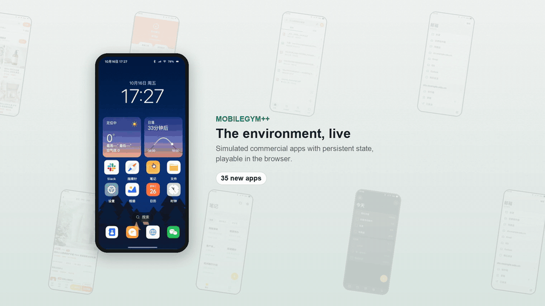
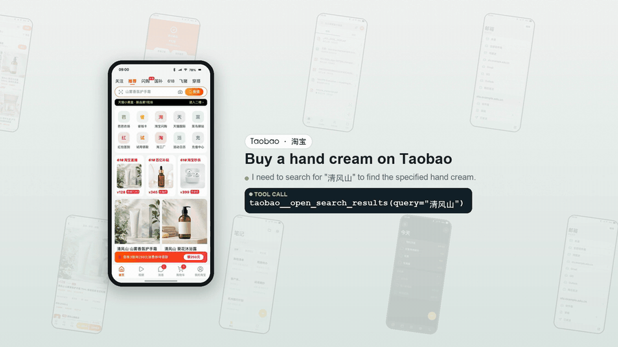
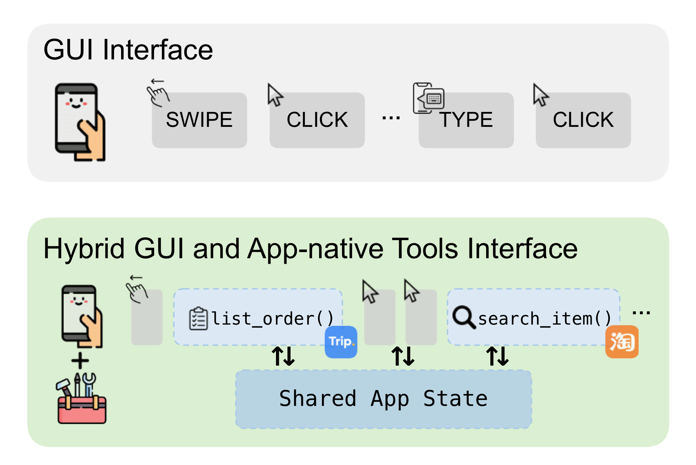
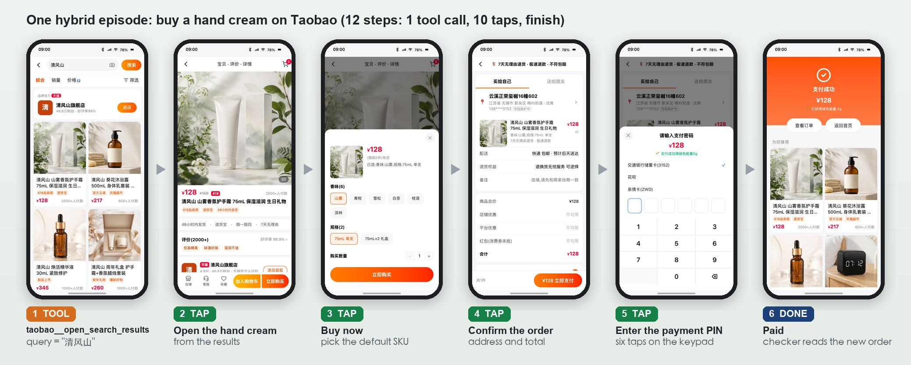
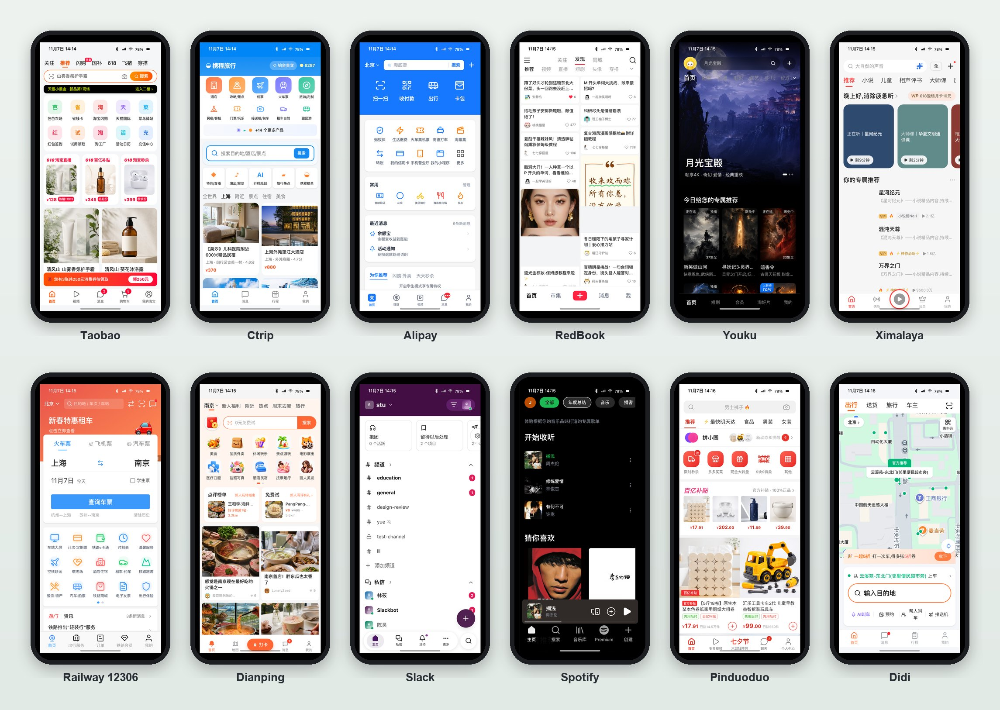
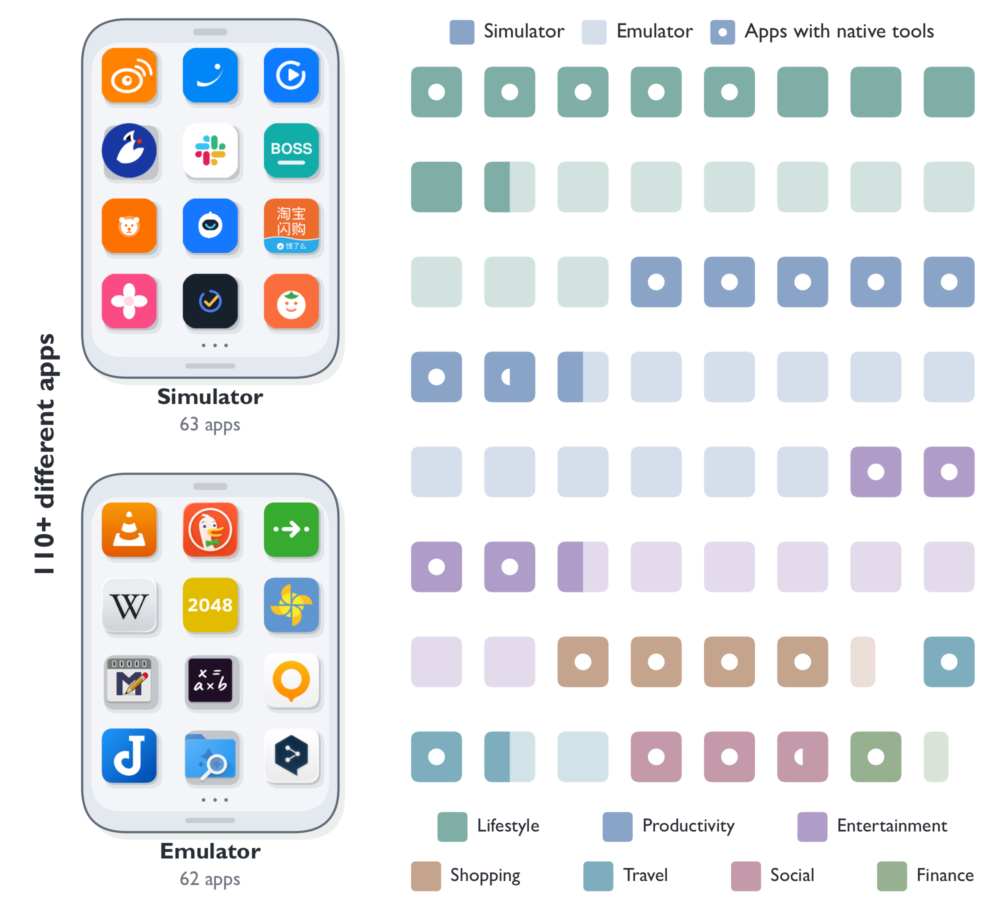
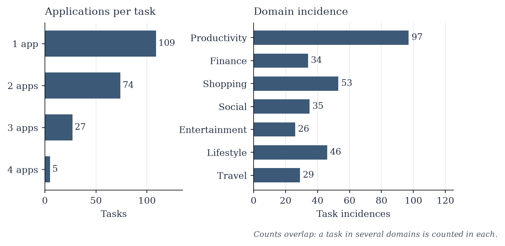

<h1 align="center">MobileGym++</h1>

<p align="center">
  <b>A phone that runs in the browser: 63 installable clients (47 commercial-style), 300+ app-native tools beside the GUI,<br>
  and 215 long-horizon tasks scored on the apps' own records.</b>
</p>

<p align="center">
  <a href="README_zh.md"><b>中文</b></a>
  &nbsp;·&nbsp;
  <a href="#quick-start"><b>Quick start</b></a>
  &nbsp;·&nbsp;
  <a href="#results-from-the-paper"><b>Results</b></a>
  &nbsp;·&nbsp;
  <a href="#what-a-tool-looks-like"><b>Tools</b></a>
  &nbsp;·&nbsp;
  <a href="docs/demo/demo.mp4"><b>Full video (42 s, MP4)</b></a>
</p>

<p align="center">
  <a href="LICENSE"></a>
  <a href="bench_env/benchmark/official.json"></a>
  <a href="#the-phone"></a>
  
</p>

<p align="center">
  
</p>

<p align="center">
  <em>Every app is a web client that keeps its own orders, bills, itineraries and messages. The whole device is one serializable snapshot.</em>
</p>

<table align="center">
  <tr>
    <td align="center" width="25%"><h2>63</h2>installable clients<br><sub>47 commercial-style · 35 built for this release</sub></td>
    <td align="center" width="25%"><h2>300+</h2>app-native tools<br><sub>across 50+ apps</sub></td>
    <td align="center" width="25%"><h2>215</h2>benchmark tasks<br><sub>7 domains · 106 cross apps</sub></td>
    <td align="center" width="25%"><h2>1</h2>snapshot per device<br><sub>reset and replay from the same state</sub></td>
  </tr>
</table>

## Why MobileGym++

Open mobile-agent data mostly comes from a few dozen emulator apps, largely system utilities and open-source clients, because third-party apps rarely reset cleanly and the full Android stack is costly to replicate at training scale. MobileGym++ rebuilds commercial apps as browser clients with persistent business state, so long workflows such as booking a trip, paying an order, or carrying a value from one app into another can be reset, replayed, and checked in parallel.

It extends [MobileGym](https://arxiv.org/abs/2605.26114) with 35 new commercial-style applications, explicit cross-app mechanisms, and a hybrid mode in which an application exposes selected functions as tools beside its GUI. Observations are screenshots, with no accessibility tree. In hybrid mode the agent also receives the foreground app's tool schemas and the structured result of each call.

## Quick start

Two terminals: one runs the phone, the other scores a model against it.

### 1. Start the phone

Node.js 22 or newer. Leave the terminal running and open <http://127.0.0.1:3000>.

```bash
git clone <this-repository> mobilegym-pp   # on the anonymized page, use "Download repository" instead
cd mobilegym-pp
zsh scripts/start_phone.sh
```

The script prints four steps: check Node.js, restore the compressed data files, install Node packages (first run only, a few minutes), and start the phone. The 215 tasks do not need map, weather, or assistant keys.

Wallpapers, theme widgets, and some media images load from a public asset CDN (`https://cdn.mobilegym.dev`); no account or key is sent. To run with no external requests, start with `VITE_CDN_BASE= zsh scripts/start_phone.sh`. The apps and tasks still work, but those images will be missing and the two home-screen widgets will show a load error.

### 2. Score your model

Python 3.11 or newer. In a second terminal, at the repository root, install the checker once:

```bash
python3 -m pip install -r bench_env/requirements.txt
python3 -m playwright install chromium
```

The second command downloads a headless Chromium once (about 150 MB). The checker drives the phone through it; starting the phone alone does not need it.

Then point it at the phone and at your OpenAI-compatible endpoint:

```bash
zsh bench_env/benchmark/run.sh \
  --mode hybrid \
  --env-url http://127.0.0.1:3000 \
  --model-base-url http://HOST:PORT/v1 \
  --model-name YourModel \
  --model-api-key "$OPENAI_API_KEY" \
  --output-dir runs/bench-hybrid
```

`--mode gui_only` uses the same 215 tasks and the same checkers, with the app-native tools turned off. With the default protocol the script runs `qwen35_session`: the system prompt and the task are sent once, the last 3 screenshots are kept, and the API `tools` list stays `mobile_use`; in hybrid mode, the foreground app's tool schemas are added to the turn in which that app comes to the front. Inside that protocol the model name selects the adapter: Qwen, Gemini, Kimi K3, DeepSeek, or GLM. Each task starts from its bound initial snapshot, so episodes are independent and run in parallel (`--parallel`, default 5). The run writes `results.jsonl` and `summary.json`. For many parallel episodes, use `scripts/server/start_nginx_gateway.sh` as described in [`docs/getting-started.md`](docs/getting-started.md).

## One agent, GUI + tools

<p align="center">
  
</p>

<p align="center">
  <em>Two tasks from the recordings: buying a hand cream on Taobao, then reading the first-quadrant to-dos in Dida (a planner app) and writing them into Notes. Taps and tool calls interleave in one episode, and both change the same application records.</em>
</p>

<p align="center">
  
</p>

<p align="center">
  <em>One benchmark task, two ways. The top path is GUI only. The bottom path interleaves the same gestures with the app's own tools.</em>
</p>

## Results (from the paper)

**Providing tools is not enough; hybrid training is what makes them pay off.** Before hybrid SFT, tool calls appear in only 20–102 of the 215 tasks and the gains are limited: the Qwen base models improve by 2.8–4.2 points, and GUI-Owl-1.5 is inconsistent and can even degrade. After hybrid SFT, the 9B and 27B models call tools in 113 and 128 tasks, using 110 and 115 distinct tools; the hybrid gain grows to **+5.6** and **+10.3** points, and episodes become **4.8** and **5.8** steps shorter.

<table>
  <thead>
    <tr>
      <th align="left" rowspan="2">Model</th>
      <th align="center" colspan="2">GUI only</th>
      <th align="center" colspan="2">Hybrid</th>
    </tr>
    <tr>
      <th align="right">Success ↑</th>
      <th align="right">Steps ↓</th>
      <th align="right">Success ↑</th>
      <th align="right">Steps ↓</th>
    </tr>
  </thead>
  <tbody>
    <tr><td colspan="5"><em>Open-weight models</em></td></tr>
    <tr>
      <td>UI-Venus-1.5-8B</td>
      <td align="right">19.5*</td><td align="right">—</td>
      <td align="right">16.3*</td><td align="right">—</td>
    </tr>
    <tr>
      <td>GUI-Owl-1.5-8B</td>
      <td align="right">13.0*</td><td align="right">33.9</td>
      <td align="right">12.6*</td><td align="right">34.6</td>
    </tr>
    <tr>
      <td>GUI-Owl-1.5-32B</td>
      <td align="right">18.6*</td><td align="right">32.3</td>
      <td align="right">23.3*</td><td align="right">36.7</td>
    </tr>
    <tr>
      <td>MAI-UI-8B</td>
      <td align="right">19.1*</td><td align="right">—</td>
      <td align="right">18.6*</td><td align="right">—</td>
    </tr>
    <tr><td colspan="5"><em>Open-data models and their base models (fine-tuned rows are indented under the base)</em></td></tr>
    <tr>
      <td>OpenMobile-1-8B</td>
      <td align="right">13.5*</td><td align="right">—</td>
      <td align="right">7.0*</td><td align="right">—</td>
    </tr>
    <tr>
      <td>Qwen3.5-9B</td>
      <td align="right">9.3*</td><td align="right">43.4</td>
      <td align="right">12.1*</td><td align="right">42.9</td>
    </tr>
    <tr>
      <td>&nbsp;&nbsp;OpenMobile-2-9B, GUI-only SFT</td>
      <td align="right">40.9</td><td align="right">—</td>
      <td align="right">41.9</td><td align="right">—</td>
    </tr>
    <tr>
      <td>&nbsp;&nbsp;OpenMobile-2-9B, hybrid SFT</td>
      <td align="right">39.1</td><td align="right">28.0</td>
      <td align="right">44.7</td><td align="right">23.2</td>
    </tr>
    <tr>
      <td>&nbsp;&nbsp;OpenMobile-2-9B, hybrid SFT + RL</td>
      <td align="right">40.5</td><td align="right">—</td>
      <td align="right">46.5</td><td align="right">—</td>
    </tr>
    <tr>
      <td>Qwen3.6-27B</td>
      <td align="right">46.5*</td><td align="right">32.0</td>
      <td align="right">50.7*</td><td align="right">28.6</td>
    </tr>
    <tr>
      <td>&nbsp;&nbsp;OpenMobile-2-27B, GUI-only SFT</td>
      <td align="right">54.9</td><td align="right">—</td>
      <td align="right">57.7</td><td align="right">—</td>
    </tr>
    <tr>
      <td>&nbsp;&nbsp;OpenMobile-2-27B, hybrid SFT</td>
      <td align="right">55.3</td><td align="right"><b>25.0</b></td>
      <td align="right">65.6</td><td align="right"><b>19.2</b></td>
    </tr>
    <tr>
      <td>&nbsp;&nbsp;OpenMobile-2-27B, hybrid SFT + RL</td>
      <td align="right"><b>57.2</b></td><td align="right">—</td>
      <td align="right"><b>67.0</b></td><td align="right">—</td>
    </tr>
  </tbody>
</table>

Success rates (%) are Table 2 of the paper and average steps are Figure 5; — means not reported. * marks a baseline the paper ran on this bench under the same protocol. Bold is the best value in each column. Table 2 also lists closed-weight models, which were not scored on MobileGym++; the Gemini 3.1 Pro Preview recording on this page is illustrative and is not a scored entry.

## Two channels, one state

Each tool is a structured query or write over its application's own objects, and it changes the same persistent state as the matching taps and keystrokes. More than 300 tools are exposed across 50-plus applications, including system clients such as Clock, Calendar and Notes.

| | GUI only | Hybrid |
| --- | --- | --- |
| Flag | `--mode gui_only` | `--mode hybrid` |
| What the agent can do | Tap, type, and scroll on the screenshot | The same gestures, plus the foreground app's tools |
| What is checked | The resulting application state | The same application state, with the same tasks, initial states and checker |

### What a tool looks like

- **One action slot.** At each step the policy picks one action from the GUI gestures and the foreground app's tools. A tool catalog is attached when its app comes to the front and removed when it leaves.
- **Same state.** A tool handler and the screen read and write one store, so `taobao__add_to_cart` changes the cart that the GUI renders.
- **Strict inputs.** Every schema sets `additionalProperties: false`, and undeclared or missing arguments are rejected with an error code. Every call returns a structured receipt.
- **Tools do not shortcut the task.** Tools come in four kinds: query, navigation, draft, and write. `taobao__prepare_checkout` opens the confirmation page; it does not create or pay the order. Every benchmark task remains solvable from the GUI alone.

<p align="center">
  
</p>

<p align="center">
  <em>One hybrid episode, recorded with Gemini 3.1 Pro Preview. A single tool call (<code>taobao__open_search_results</code>) jumps to the results. The purchase and the payment PIN are still done on the GUI, and the checker reads the new paid order.</em>
</p>

```json
{
  "name": "taobao__add_to_cart",
  "description": "Add one catalog item with an exact valid SKU description and quantity to the cart.",
  "inputSchema": {
    "type": "object",
    "properties": {
      "item_id": { "type": "string" },
      "sku_description": { "type": "string" },
      "quantity": { "type": "integer", "minimum": 1, "maximum": 99 }
    },
    "required": ["item_id", "sku_description", "quantity"],
    "additionalProperties": false
  }
}
```

Example receipts: the first is step 1 of the episode above; the second shows how a call with a missing argument is rejected.

```json
{ "call_id": "tool_call_1", "name": "taobao__open_search_results", "ok": true,
  "output": { "route": "/search/result?q=%E6%B8%85%E9%A3%8E%E5%B1%B1", "query": "清风山" } }

{ "call_id": "tool_call_2", "name": "taobao__add_to_cart", "ok": false,
  "error": { "code": "INVALID_ARGUMENT", "message": "\"quantity\" is required." } }
```

## The phone

The phone installs **63** clients: **35** built for this release and **28** kept from MobileGym. **47** are commercial-style applications and **16** are system clients. They cover travel, shopping, finance, content, social, office, and local services.

<p align="center">
  
</p>

<p align="center">
  
</p>

The upper phone is this repository; the lower phone (Android-emulator apps) is not. Each square stands for two applications, and a dot marks an application that exposes native tools.

Each client keeps its own business objects, such as orders, bills, itineraries and messages, and those objects change as the agent acts. Clipboard transfer, app-to-app sharing, payment redirection, and media selection connect the clients, so a workflow can leave one application and write into another. The whole device can be snapshotted and restored, so every run starts from the same state.

Among the new clients, the median application exposes 37 routes, 166 interactive actions, and 86 page transitions, with a median depth of 3 from its home screen. Relative to the 12 prior MobileGym business apps, the new clients reach 1.48× the interactive actions and 1.91× the page transitions.

<details>
<summary>Clients</summary>

**Commerce (10).** Alipay, Taobao, Taobao Shangou, JD, Pinduoduo, Xianyu, Vipshop, Suning, eBay, Kapi.

**Local life (9).** Meituan, Dianping, Ctrip, Qunar, Didi, Railway 12306, Map, Cainiao, Luckin.

**Social and media (15).** WeChat, RedBook, Weibo, Bilibili, Douban, Reddit, X, WeChat Reading, Fanqie Novel, Ximalaya, Podcasts, Spotify, Tencent Video, Youku, Maoyan.

**Work and personal (13).** Slack, Tencent Meeting, Google Drive, Mail, Dida, flomo, Days Matter, Fanqie Todo, Xiaorichang, BOSS Zhipin, Baicizhan, Keep, Meiyou.

**System (16).** Answer sheet, Browser, Calculator, Calculator 2, Calendar, Clock, Compass, Phone, Files, Gallery, Notes, Settings, SMS, Themes, plus Weather and NetEase Cloud Music, which are stored under `apps/`.

</details>

## MobileGym++ Bench

The benchmark asks whether an agent can reach a target change in application state inside this phone: find the right screen, and, when the task crosses apps, recover a live value from another client's store and put it in the right field. Instructions are phrased as user goals and do not name widgets, tools, or checker fields.

There are **215** tasks across **7** business domains, touching **48** of the installed clients. 109 use one app, 74 use two, 27 use three, and 5 use four, so **106** tasks cross applications. A task can sit in more than one domain; the right-hand counts overlap and do not add up to 215.

<p align="center">
  
</p>

Episodes average 19 to 43 steps depending on the model and mode (Figure 5). Each task is a user goal, a bound initial state, and a checker over the before/after difference of application state. The checker does not watch the trajectory or the screenshots, and it does not ask another model to judge. The reported number is success rate.

The task list, stable ids, and instructions are in [`bench_env/benchmark/official.json`](bench_env/benchmark/official.json).

### How this environment compares

| Environment | Platform | Commercial apps | Tasks | Cross-app | GUI | App-native tools | Controllable reset |
| --- | --- | ---: | ---: | --- | --- | --- | --- |
| AppWorld | API | 9 | 750 | yes | — | — | yes |
| AndroidLab | Emulator | 5 | 138 | — | yes | — | — |
| AndroidWorld | Emulator | 0 | 116 | yes | yes | — | — |
| SPA-Bench | Real device | 58 | 340 | yes | yes | — | — |
| MobileWorld | Emulator | 4 | 201 | yes | yes | — | — |
| MobileGym | Simulator | 12 | 416 | limited | yes | — | yes |
| **MobileGym++** | **Simulator** | **35** | **215** | **yes** | **yes** | **yes** | **yes** |

Commercial apps follow the paper's definition: for MobileGym++, the 35 newly built applications (63 installable in total).

### What drives the gains (from the paper)

- **Tools pay off after hybrid training**, as shown under Results above.
- **Tool use transfers to unseen tools.** On MobileWorld MCP, whose tools are never seen in training, hybrid SFT reaches 27.5 (9B) and 45.0 (27B), against 12.5 and 35.0 for GUI-only SFT.
- **Coverage over repetition.** At a fixed budget of 2K trajectories, spreading them from 15 to 53 apps raises Pass@1 on unseen apps from 60.7 to 67.5.

The training data (11.6K demonstration trajectories and 2K+ executable RL tasks), the Android-emulator playground, and the model weights are released separately and are not in this repository.

## Layout

| Path | What it is |
| --- | --- |
| `apps/` | Commercial-style clients, plus Weather and NetEase Cloud Music |
| `system/` | System clients: clock, notes, calendar, files, settings, and the rest |
| `os/` | The device shell: launcher, status bar, files, clipboard, notifications |
| `app_tools/` | Schemas and handlers for the app-native tools |
| `bench_env/benchmark/` | The 215 tasks and `run.sh` |
| `bench_env/task/` | Task setup and the checkers |
| `docs/getting-started.md` | From a fresh download to one finished task |

## License

Code is Apache 2.0 ([`LICENSE`](LICENSE)). Data terms, the third-party disclaimer, and notices are in [`LICENSE-DATA`](LICENSE-DATA), [`DISCLAIMER.md`](DISCLAIMER.md), and [`NOTICE`](NOTICE). The simulated apps are research targets. They are not the products they are named after, and this project is not affiliated with those companies.
