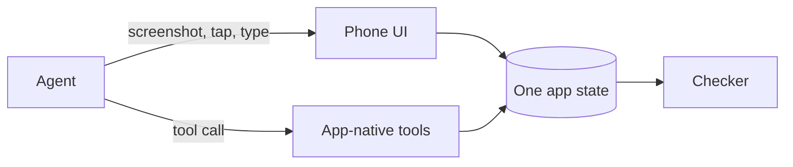

# MobileGym++

<p align="center">
  <a href="README_zh.md">中文</a>
</p>

<p align="center">
  <a href="LICENSE"></a>
  <a href="bench_env/benchmark/official.json"></a>
  <a href="#what-is-installed"></a>
</p>

<p align="center">
  <a href="https://os-copilot.github.io/OpenMobile2-Home"><b>Homepage</b></a>
  &nbsp;·&nbsp;
  <a href="https://github.com/OpenMobile2/OpenMobile2-Code"><b>Agent code</b></a>
  &nbsp;·&nbsp;
  <a href="https://huggingface.co/datasets/OpenMobile-2/OpenMobile-Data"><b>Dataset</b></a>
  &nbsp;·&nbsp;
  <a href="https://huggingface.co/OpenMobile-2/OpenMobile-27B"><b>Model</b></a>
  &nbsp;·&nbsp;
  <a href="https://mobilegym-mock-production.up.railway.app"><b>Try the phone</b></a>
</p>

A phone that runs in the browser, and a 215-task benchmark on that phone. An agent can tap the screen, call a tool the app itself exposes, or do both in one episode. Taps and tool calls write the same application state. Every task is scored by a programmatic checker, not by a person watching the video.

This repository is the **environment**. Training code, the other benchmarks, and the model release live in [OpenMobile2-Code](https://github.com/OpenMobile2/OpenMobile2-Code). It is not the earlier MobileGym release (28 apps, a different task set, and a separate data download).



## Two ways to act

Both modes use the same 215 tasks and the same checkers.

| | GUI only | Hybrid |
| --- | --- | --- |
| Flag | `--mode gui_only` | `--mode hybrid` |
| What the agent can do | Tap, type, and scroll on the screenshot | The same gestures, plus tools such as `wechat__send_text_message` |
| What gets checked | The resulting app state | The same resulting app state |

A tool does not bypass the phone. It changes the same state a tap would change. The checker reads that state.

## What is installed

The paper counts **63 installable clients**: **47** commercial-style applications and **16** system clients.

On disk, `apps/` has 49 directories and `system/` has 14. Weather and NetEase Cloud Music live under `apps/` and are still counted with the inherited system clients, which is why 49 + 14 and 47 + 16 are the same 63.

**MobileGym++ Bench** has **215** tasks and touches **48** of these clients. That 48 is the span of the tasks, not the size of the phone. Of the 215 tasks, 109 use one app, 74 use two, 27 use three, and 5 use four. 106 tasks cross apps. A task can belong to more than one domain, so domain counts overlap.

The task list, stable ids, and instructions are in [`bench_env/benchmark/official.json`](bench_env/benchmark/official.json).

<details>
<summary>Clients</summary>

**Commerce.** Alipay, Taobao, Taobao Shangou, JD, Pinduoduo, Xianyu, Vipshop, Suning, eBay, Kapi.

**Local life.** Meituan, Dianping, Ctrip, Qunar, Didi, Railway 12306, Amap-style Map, Cainiao, Luckin.

**Social and media.** WeChat, RedBook, Weibo, Bilibili, Douban, Reddit, X, WeChat Reading, Fanqie Novel, Ximalaya, Podcasts, NetEase Cloud Music, Spotify, Tencent Video, Youku, Maoyan.

**Work and personal.** Slack, Tencent Meeting, Google Drive, Mail, Dida, flomo, Days Matter, Fanqie Todo, Xiaorichang, BOSS Zhipin, Baicizhan, Keep, Meiyou.

**System, under `system/`.** Answer sheet, Browser, Calculator, Calculator 2, Calendar, Clock, Compass, Phone, Files, Gallery, Notes, Settings, SMS, Themes.

Weather and NetEase Cloud Music are under `apps/`.

</details>

## Layout

| Path | What it is |
| --- | --- |
| `apps/` | Commercial-style clients, plus Weather and NetEase Cloud Music |
| `system/` | The 14 system clients |
| `os/` | The device shell: launcher, status bar, files, clipboard, notifications |
| `app_tools/` | Schemas and handlers for the app-native tools |
| `bench_env/benchmark/` | The official 215-task set and `run.sh` |
| `bench_env/task/` | Task setup and the programmatic checkers |
| `bench_env/` | The browser driver and the hybrid agent |
| `docs/getting-started.md` | From a fresh clone to one finished task |
| `docs/guides/` | How to add an app, a task, or an agent adapter |

Open the phone if you want to see the product. Open `bench_env/benchmark/` if you want to score a model. The other benchmark suites are not in this repository.

## Run the phone

Node.js 22 or newer, and npm.

```bash
git clone https://github.com/OpenMobile2/openmobile2.git
cd openmobile2
npm install
npm run dev
```

Vite serves the phone at the URL it prints, usually `http://127.0.0.1:3000`.

Wallpapers and many in-app images are not in git. Point the dev server at the public media host:

```bash
VITE_CDN_BASE=https://cdn.mobilegym.dev npm run dev
```

`docs/getting-started.md` also describes a local copy of that media. Maps, live weather, and the in-phone assistant read optional `VITE_*` keys from the environment. The 215 tasks are written against bundled snapshots and do not need those keys.

There is a hosted phone at <https://mobilegym-mock-production.up.railway.app>. It is the same kind of simulator. The commands above run this repository on your machine.

## Run the 215 tasks

Python 3.11 or newer. Start the phone first, then in another terminal at the repository root:

```bash
python3 -m pip install -r bench_env/requirements.txt
python3 -m playwright install chromium

zsh bench_env/benchmark/run.sh \
  --mode hybrid \
  --env-url http://127.0.0.1:3000 \
  --model-base-url http://HOST:PORT/v1 \
  --model-name YourModel \
  --model-api-key "$OPENAI_API_KEY" \
  --output-dir runs/bench-hybrid
```

Use any OpenAI-compatible `/v1` endpoint. `--mode gui_only` keeps the same tasks and checkers and turns the app-native tools off. The run writes `results.jsonl`, `summary.json`, and per-task artifacts under the output directory. Details are in [`bench_env/benchmark/README.md`](bench_env/benchmark/README.md).

For more than a handful of parallel episodes, build the static phone and use `scripts/server/start_nginx_gateway.sh`, as described in the getting-started guide. The Vite dev server is one process.

## License

Code is Apache 2.0, in [`LICENSE`](LICENSE). Data terms, the third-party disclaimer, and notices are in [`LICENSE-DATA`](LICENSE-DATA), [`DISCLAIMER.md`](DISCLAIMER.md), and [`NOTICE`](NOTICE). The simulated apps are research targets. They are not the products they are named after, and this project is not affiliated with those companies.
