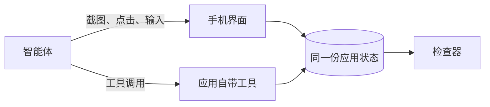

# MobileGym++

<p align="center">
  <a href="README.md">English</a>
</p>

<p align="center">
  <a href="LICENSE"></a>
  <a href="bench_env/benchmark/official.json"></a>
  <a href="#装了什么"></a>
</p>

<p align="center">
  <a href="https://os-copilot.github.io/OpenMobile2-Home"><b>主页</b></a>
  &nbsp;·&nbsp;
  <a href="https://github.com/OpenMobile2/OpenMobile2-Code"><b>智能体代码</b></a>
  &nbsp;·&nbsp;
  <a href="https://huggingface.co/datasets/OpenMobile-2/OpenMobile-Data"><b>数据集</b></a>
  &nbsp;·&nbsp;
  <a href="https://huggingface.co/OpenMobile-2/OpenMobile-27B"><b>模型</b></a>
  &nbsp;·&nbsp;
  <a href="https://mobilegym-mock-production.up.railway.app"><b>打开手机</b></a>
</p>

一部在浏览器里运行的手机，加上在这部手机上的 215 道题。智能体可以点屏幕，也可以调用应用自己暴露的工具，还可以在同一条轨迹里交替使用。点击和工具调用写进同一份应用状态。每一题由程序检查器打分，不是靠人看录像。

这个仓库是**环境**。训练代码、其他评测和模型发布在 [OpenMobile2-Code](https://github.com/OpenMobile2/OpenMobile2-Code)。它也不是前作 MobileGym（28 个应用、另一套题、单独下载的数据包）。



## 两种做法

两种模式用同一套 215 题、同一套检查器。

| | 只点屏幕 | 可调工具 |
| --- | --- | --- |
| 参数 | `--mode gui_only` | `--mode hybrid` |
| 智能体能做的 | 在截图上点击、输入、滑动 | 同样的手势，再加上 `wechat__send_text_message` 这类工具 |
| 检查的是 | 做完之后的应用状态 | 同一份应用状态 |

工具不是绕过手机。它改的是点击也会改的那份状态。检查器读的就是这份状态。

## 装了什么

论文计入 **63 个可安装客户端**：**47** 个商业风格应用，**16** 个系统客户端。

磁盘上 `apps/` 有 49 个目录，`system/` 有 14 个。天气和网易云音乐放在 `apps/` 里，论文仍把它们算进继承下来的系统客户端。所以 49 + 14 和 47 + 16 是同一个 63。

**MobileGym++ Bench** 有 **215** 题，用到其中 **48** 个客户端。48 是题目覆盖到的范围，不是手机里一共有多少个应用。215 题里，109 题用 1 个应用，74 题用 2 个，27 题用 3 个，5 题用 4 个。跨应用的有 106 题。一道题可以同时属于多个领域，领域计数会重叠。

题面、稳定 id 和说明在 [`bench_env/benchmark/official.json`](bench_env/benchmark/official.json)。

<details>
<summary>客户端名单</summary>

**商业。** 支付宝、淘宝、淘宝闪购、京东、拼多多、闲鱼、唯品会、苏宁易购、eBay、卡皮记账。

**本地生活。** 美团外卖、大众点评、携程旅行、去哪儿旅行、滴滴出行、铁路 12306、地图、菜鸟、瑞幸咖啡。

**社交和内容。** 微信、小红书、微博、哔哩哔哩、豆瓣、Reddit、X、微信读书、番茄免费小说、喜马拉雅、播客、网易云音乐、Spotify、腾讯视频、优酷视频、猫眼。

**工作和日常。** Slack、腾讯会议、Google 云端硬盘、邮件、滴答清单、flomo、倒数日、番茄 ToDo、小日常、BOSS 直聘、百词斩、Keep、美柚。

**系统，在 `system/`。** 答题卡、浏览器、计算器、计算器 2、日历、时钟、指南针、电话、文件、相册、笔记、设置、短信、主题商店。

天气和网易云音乐在 `apps/`。

</details>

## 目录

| 路径 | 是什么 |
| --- | --- |
| `apps/` | 商业风格客户端，以及天气和网易云音乐 |
| `system/` | 14 个系统客户端 |
| `os/` | 设备外壳：桌面、状态栏、文件、剪贴板、通知 |
| `app_tools/` | 应用自带工具的 schema 和处理函数 |
| `bench_env/benchmark/` | 正式的 215 题和 `run.sh` |
| `bench_env/task/` | 题目的初始化和程序检查器 |
| `bench_env/` | 浏览器驱动和混合动作智能体 |
| `docs/getting-started.md` | 从刚克隆到跑完一道题 |
| `docs/guides/` | 怎么加一个应用、一道题，或一个智能体适配器 |

想看产品，就打开手机。想给模型打分，就看 `bench_env/benchmark/`。其他评测不在这个仓库里。

## 打开手机

需要 Node.js 22 或更新版本，以及 npm。

```bash
git clone https://github.com/OpenMobile2/openmobile2.git
cd openmobile2
npm install
npm run dev
```

Vite 会打印地址，一般是 `http://127.0.0.1:3000`。

壁纸和不少应用里的图片不在 git 里。开发时可以指向公开的媒体地址：

```bash
VITE_CDN_BASE=https://cdn.mobilegym.dev npm run dev
```

`docs/getting-started.md` 里还有把这份媒体放到本机的做法。地图、实时天气和手机里的助手可以读可选的 `VITE_*` 环境变量。215 道题按自带的离线快照来写，不需要这些密钥。

线上有一部可点的手机：<https://mobilegym-mock-production.up.railway.app>。它是同一类模拟器。上面的命令是在你自己的机器上跑这个仓库。

## 跑 215 题

需要 Python 3.11 或更新版本。先把手机开着，再在另一个终端、仓库根目录执行：

```bash
python3 -m pip install -r bench_env/requirements.txt
python3 -m playwright install chromium

zsh bench_env/benchmark/run.sh \
  --mode hybrid \
  --env-url http://127.0.0.1:3000 \
  --model-base-url http://HOST:PORT/v1 \
  --model-name YourModel \
  --model-api-key "$OPENAI_API_KEY" \
  --output-dir runs/bench-hybrid
```

模型地址用任何兼容 OpenAI `/v1` 的接口。`--mode gui_only` 仍是这 215 题和同一套检查器，只是关掉应用自带工具。跑完会在输出目录写下 `results.jsonl`、`summary.json` 和每题的记录。细节在 [`bench_env/benchmark/README.md`](bench_env/benchmark/README.md)。

并行比较多的时候，先构建静态页面，再用 `scripts/server/start_nginx_gateway.sh`。做法写在入门文档里。Vite 的开发服务器是单进程。

## 许可

代码是 Apache 2.0，见 [`LICENSE`](LICENSE)。数据条款、第三方免责声明和声明分别在 [`LICENSE-DATA`](LICENSE-DATA)、[`DISCLAIMER.md`](DISCLAIMER.md)、[`NOTICE`](NOTICE)。这些模拟应用是研究用的目标，不是它们所模仿的产品，本项目也与那些公司没有隶属关系。
