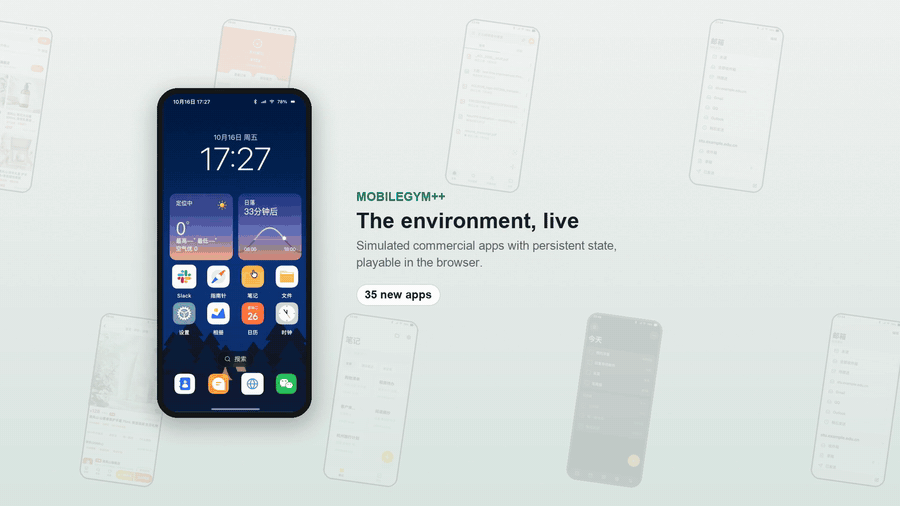
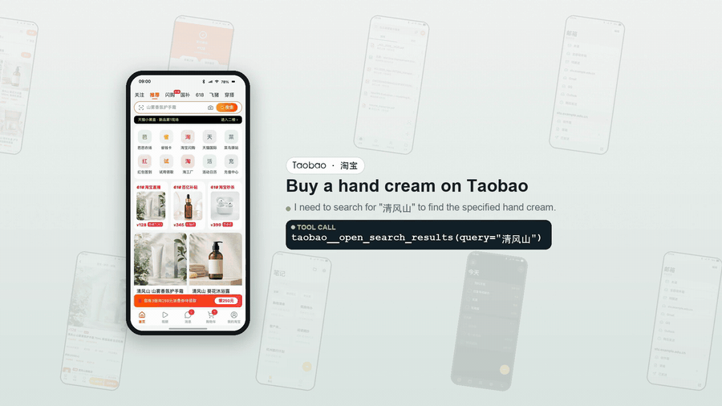
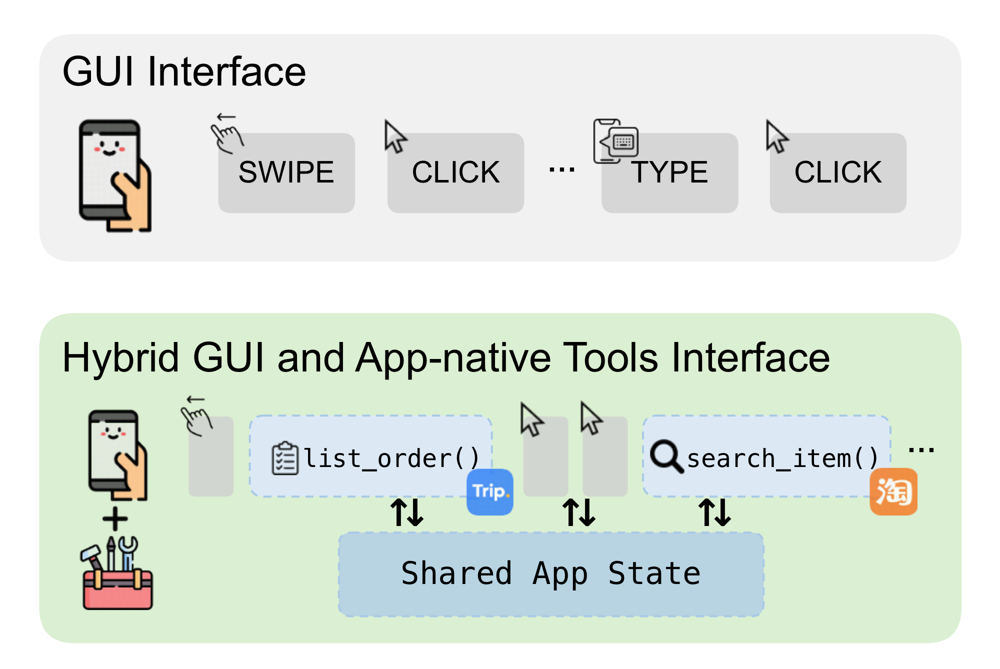
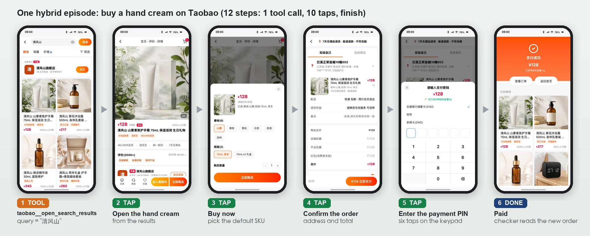
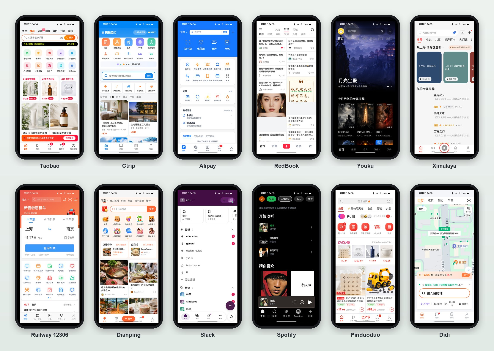
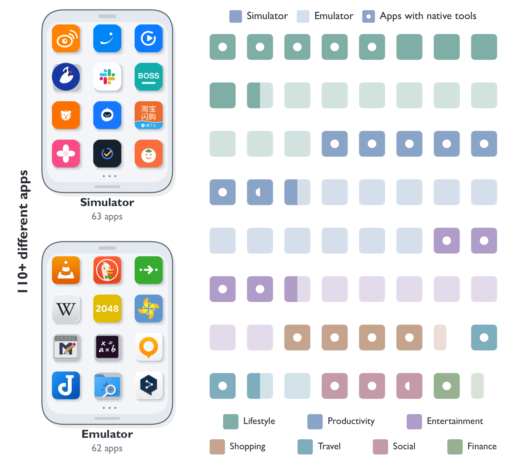
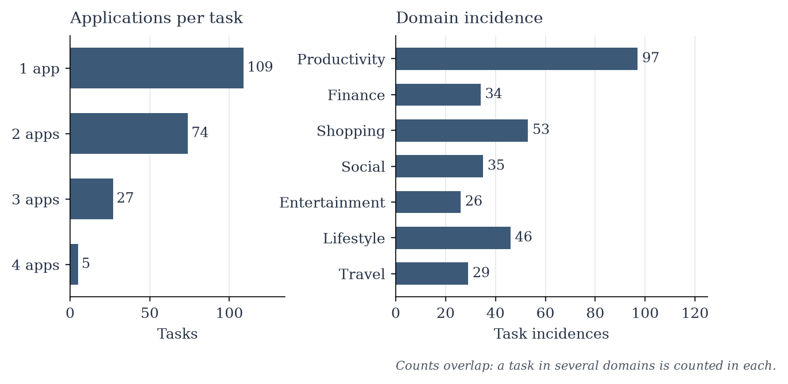

<h1 align="center">MobileGym++</h1>

<p align="center">
  <b>一部在浏览器里运行的手机：63 个可安装客户端（其中 47 个仿商业应用），界面旁边配有 300 多个应用自带工具，<br>
  以及 215 道按应用自身记录判分的长流程任务。</b>
</p>

<p align="center">
  <a href="README.md"><b>English</b></a>
  &nbsp;·&nbsp;
  <a href="#快速开始"><b>快速开始</b></a>
  &nbsp;·&nbsp;
  <a href="#论文结果"><b>结果</b></a>
  &nbsp;·&nbsp;
  <a href="#工具长什么样"><b>工具</b></a>
  &nbsp;·&nbsp;
  <a href="docs/demo/demo.mp4"><b>完整视频（42 秒，MP4）</b></a>
</p>

<p align="center">
  <a href="LICENSE"></a>
  <a href="bench_env/benchmark/official.json"></a>
  <a href="#这部手机"></a>
  
</p>

<p align="center">
  
</p>

<p align="center">
  <em>每个应用都是一个网页客户端，保管自己的订单、账单、行程和消息。整部手机是一份可以序列化的快照。</em>
</p>

<table align="center">
  <tr>
    <td align="center" width="25%"><h2>63</h2>可安装客户端<br><sub>47 个仿商业应用 · 35 个为本次新做</sub></td>
    <td align="center" width="25%"><h2>300+</h2>应用自带工具<br><sub>覆盖 50 多个应用</sub></td>
    <td align="center" width="25%"><h2>215</h2>道评测题<br><sub>7 个业务领域 · 106 道跨应用</sub></td>
    <td align="center" width="25%"><h2>1</h2>份整机快照<br><sub>从同一状态重置、重放</sub></td>
  </tr>
</table>

## 为什么做 MobileGym++

开源的手机智能体数据，大多来自几十个模拟器里的应用，主要是系统工具和开源客户端。原因是第三方应用很难干净地重置，完整的安卓环境在训练规模上复制起来也很贵。MobileGym++ 把商业应用重建成带持久业务状态的浏览器客户端，所以订行程、付订单、把一个应用里的值带到另一个应用这类长流程，都可以重置、重放，并行检查。

它在 [MobileGym](https://arxiv.org/abs/2605.26114) 的基础上新做了 35 个仿商业应用，补上了明确的跨应用机制，并加入了可调工具模式：应用在图形界面旁边，把自己的一部分功能暴露成工具。智能体的观测是截图，没有无障碍树。在可调工具模式下，它还会拿到前台应用的工具定义，以及每次调用的结构化返回。

## 快速开始

开两个终端：一个跑手机，另一个用你的模型在上面打分。

### 1. 起手机

需要 Node.js 22 或更新版本。终端不要关，浏览器打开 <http://127.0.0.1:3000>。

```bash
git clone <本仓库地址> mobilegym-pp   # 在匿名页面上请用「Download repository」下载
cd mobilegym-pp
zsh scripts/start_phone.sh
```

脚本会依次打印四步：检查 Node.js、恢复压缩存放的数据文件、安装 Node 依赖（只有第一次，需要几分钟）、启动手机。215 道题不需要地图、天气或助手的密钥。

壁纸、主题小组件和部分媒体图片从一个公开的素材 CDN（`https://cdn.mobilegym.dev`）加载，不会发送任何账号或密钥。想完全不访问外部网络，用 `VITE_CDN_BASE= zsh scripts/start_phone.sh` 启动；应用和题目都照常能用，只是这些图片不显示，桌面上的两个小组件会显示加载失败。

### 2. 用你的模型打分

需要 Python 3.11 或更新版本。另开一个终端，在仓库根目录先装一次检查器：

```bash
python3 -m pip install -r bench_env/requirements.txt
python3 -m playwright install chromium
```

第二条命令会下载一次无头 Chromium（约 150 MB）。检查器通过它来操作手机；只起手机不需要它。

然后把手机和你自己的、兼容 OpenAI `/v1` 的模型接上：

```bash
zsh bench_env/benchmark/run.sh \
  --mode hybrid \
  --env-url http://127.0.0.1:3000 \
  --model-base-url http://HOST:PORT/v1 \
  --model-name YourModel \
  --model-api-key "$OPENAI_API_KEY" \
  --output-dir runs/bench-hybrid
```

`--mode gui_only` 仍是这 215 题和同一套检查器，只是关掉应用自带工具。默认协议是 `qwen35_session`：系统提示和题目只发一次，只留最近 3 张截图，接口里的 `tools` 只有 `mobile_use`；可调工具模式下，应用切到前台的那一轮会附上它的工具定义。模型名字会选适配：Qwen、Gemini、Kimi K3、DeepSeek 或 GLM。每题都从绑定的初始快照开始，回合之间互不影响，可以并行跑（`--parallel`，默认 5）。跑完会写下 `results.jsonl` 和 `summary.json`。并行很多路时，用 `scripts/server/start_nginx_gateway.sh`，做法在 [`docs/getting-started.md`](docs/getting-started.md)。

## 一个智能体，点击加工具

<p align="center">
  
</p>

<p align="center">
  <em>录像里的两道题：在淘宝买一支护手霜；读出滴答清单里第一象限的待办，写进笔记。同一个回合里点击和工具调用交替出现，改的是同一份应用数据。</em>
</p>

<p align="center">
  
</p>

<p align="center">
  <em>同一道题，两种做法。上面一条只点屏幕；下面一条把同样的手势和应用自己的工具交替使用。</em>
</p>

## 论文结果

**光给工具不够，hybrid 训练才让工具真正起作用。** hybrid SFT 之前，215 道题里只有 20 到 102 道会调用工具，收益有限：Qwen 基座模型只涨 2.8 到 4.2 分，GUI-Owl-1.5 时好时坏，甚至会变差。hybrid SFT 之后，9B 和 27B 分别在 113 道和 128 道题里调用工具，用到 110 种和 115 种工具；可调工具带来的提升增加到 **+5.6** 和 **+10.3** 分，回合分别少 **4.8** 和 **5.8** 步。

<table>
  <thead>
    <tr>
      <th align="left" rowspan="2">模型</th>
      <th align="center" colspan="2">只点屏幕</th>
      <th align="center" colspan="2">可调工具</th>
    </tr>
    <tr>
      <th align="right">成功率 ↑</th>
      <th align="right">步数 ↓</th>
      <th align="right">成功率 ↑</th>
      <th align="right">步数 ↓</th>
    </tr>
  </thead>
  <tbody>
    <tr><td colspan="5"><em>开放权重模型</em></td></tr>
    <tr>
      <td>UI-Venus-1.5-8B</td>
      <td align="right">19.5*</td><td align="right">—</td>
      <td align="right">16.3*</td><td align="right">—</td>
    </tr>
    <tr>
      <td>GUI-Owl-1.5-8B</td>
      <td align="right">13.0*</td><td align="right">33.9</td>
      <td align="right">12.6*</td><td align="right">34.6</td>
    </tr>
    <tr>
      <td>GUI-Owl-1.5-32B</td>
      <td align="right">18.6*</td><td align="right">32.3</td>
      <td align="right">23.3*</td><td align="right">36.7</td>
    </tr>
    <tr>
      <td>MAI-UI-8B</td>
      <td align="right">19.1*</td><td align="right">—</td>
      <td align="right">18.6*</td><td align="right">—</td>
    </tr>
    <tr><td colspan="5"><em>开放数据模型及其基座模型（微调后的行缩进在基座模型下）</em></td></tr>
    <tr>
      <td>OpenMobile-1-8B</td>
      <td align="right">13.5*</td><td align="right">—</td>
      <td align="right">7.0*</td><td align="right">—</td>
    </tr>
    <tr>
      <td>Qwen3.5-9B</td>
      <td align="right">9.3*</td><td align="right">43.4</td>
      <td align="right">12.1*</td><td align="right">42.9</td>
    </tr>
    <tr>
      <td>&nbsp;&nbsp;OpenMobile-2-9B，只点屏幕 SFT</td>
      <td align="right">40.9</td><td align="right">—</td>
      <td align="right">41.9</td><td align="right">—</td>
    </tr>
    <tr>
      <td>&nbsp;&nbsp;OpenMobile-2-9B，hybrid SFT</td>
      <td align="right">39.1</td><td align="right">28.0</td>
      <td align="right">44.7</td><td align="right">23.2</td>
    </tr>
    <tr>
      <td>&nbsp;&nbsp;OpenMobile-2-9B，hybrid SFT + RL</td>
      <td align="right">40.5</td><td align="right">—</td>
      <td align="right">46.5</td><td align="right">—</td>
    </tr>
    <tr>
      <td>Qwen3.6-27B</td>
      <td align="right">46.5*</td><td align="right">32.0</td>
      <td align="right">50.7*</td><td align="right">28.6</td>
    </tr>
    <tr>
      <td>&nbsp;&nbsp;OpenMobile-2-27B，只点屏幕 SFT</td>
      <td align="right">54.9</td><td align="right">—</td>
      <td align="right">57.7</td><td align="right">—</td>
    </tr>
    <tr>
      <td>&nbsp;&nbsp;OpenMobile-2-27B，hybrid SFT</td>
      <td align="right">55.3</td><td align="right"><b>25.0</b></td>
      <td align="right">65.6</td><td align="right"><b>19.2</b></td>
    </tr>
    <tr>
      <td>&nbsp;&nbsp;OpenMobile-2-27B，hybrid SFT + RL</td>
      <td align="right"><b>57.2</b></td><td align="right">—</td>
      <td align="right"><b>67.0</b></td><td align="right">—</td>
    </tr>
  </tbody>
</table>

成功率（%）来自论文 Table 2，平均步数来自 Figure 5；「—」表示论文没有给出。星号表示论文在这个基准上按同一协议跑出的基线。每列最好的值加粗。Table 2 里的闭源模型没有在 MobileGym++ 上给分；本页用 Gemini 3.1 Pro Preview 录制的回合只作演示，不是计分结果。

## 两条路，一份状态

每个工具都是对本应用自己对象的一次结构化查询或写入，改的是点击和输入也会改的那份持久状态。工具一共 300 多个，分布在 50 多个应用里，包括时钟、日历、笔记这类系统客户端。

| | 只点屏幕 | 可调工具 |
| --- | --- | --- |
| 参数 | `--mode gui_only` | `--mode hybrid` |
| 智能体能做的 | 在截图上点击、输入、滑动 | 同样的手势，再加上前台应用的工具 |
| 检查的是 | 做完之后的应用状态 | 同一份应用状态，题目、初始状态和检查器都一样 |

### 工具长什么样

- **只有一个动作位。** 每一步，策略从图形界面手势和前台应用的工具里选一个动作。应用切到前台时挂上它的工具目录，离开时撤下。
- **同一份状态。** 工具处理函数和界面读写同一份数据，所以 `taobao__add_to_cart` 改的就是界面上显示的购物车。
- **参数严格。** 每个工具定义都设了 `additionalProperties: false`，多传或漏传参数都会被拒绝并返回错误码。每次调用都返回一份结构化回执。
- **工具不能替你走捷径。** 工具分四类：查询、跳转、草稿、写入。`taobao__prepare_checkout` 只打开确认页，不会创建或支付订单。基准里的每一题都可以只靠界面完成。

<p align="center">
  
</p>

<p align="center">
  <em>一个可调工具的回合，用 Gemini 3.1 Pro Preview 录制。一次工具调用（<code>taobao__open_search_results</code>）直接跳到搜索结果；下单和输入支付密码仍然在界面上完成，检查器读取新生成的已付款订单。</em>
</p>

```json
{
  "name": "taobao__add_to_cart",
  "description": "Add one catalog item with an exact valid SKU description and quantity to the cart.",
  "inputSchema": {
    "type": "object",
    "properties": {
      "item_id": { "type": "string" },
      "sku_description": { "type": "string" },
      "quantity": { "type": "integer", "minimum": 1, "maximum": 99 }
    },
    "required": ["item_id", "sku_description", "quantity"],
    "additionalProperties": false
  }
}
```

回执示例：第一条是上面那个回合的第 1 步；第二条演示漏传参数时调用如何被拒绝。

```json
{ "call_id": "tool_call_1", "name": "taobao__open_search_results", "ok": true,
  "output": { "route": "/search/result?q=%E6%B8%85%E9%A3%8E%E5%B1%B1", "query": "清风山" } }

{ "call_id": "tool_call_2", "name": "taobao__add_to_cart", "ok": false,
  "error": { "code": "INVALID_ARGUMENT", "message": "\"quantity\" is required." } }
```

## 这部手机

手机里装了 **63** 个客户端：这次新做的 **35** 个，加上从 MobileGym 留下来的 **28** 个。其中 **47** 个是仿商业应用，**16** 个是系统客户端。覆盖出行、购物、财务、内容、社交、办公和本地生活。

<p align="center">
  
</p>

<p align="center">
  
</p>

上面那部是这个仓库；下面那部（安卓模拟器里的应用）不在这里。每一格代表两个应用，圆点表示该应用暴露了自带工具。

每个客户端保管自己的业务对象，例如订单、账单、行程、消息，并随着操作变化。剪贴板、应用间分享、支付跳转和媒体选择把它们连起来，所以一条流程可以离开一个应用，写进另一个应用。整机可以做成快照再恢复，每一次运行都从同一状态出发。

新客户端里，中位水平是 37 条路由、166 个可交互动作、86 次页面跳转，从首页出发的中位深度是 3。和此前 MobileGym 的 12 个业务应用比，新客户端的可交互动作是 1.48 倍，页面跳转是 1.91 倍。

<details>
<summary>客户端名单</summary>

**商业（10）。** 支付宝、淘宝、淘宝闪购、京东、拼多多、闲鱼、唯品会、苏宁易购、eBay、卡皮记账。

**本地生活（9）。** 美团外卖、大众点评、携程旅行、去哪儿旅行、滴滴出行、铁路 12306、地图、菜鸟、瑞幸咖啡。

**社交和内容（15）。** 微信、小红书、微博、哔哩哔哩、豆瓣、Reddit、X、微信读书、番茄免费小说、喜马拉雅、播客、Spotify、腾讯视频、优酷视频、猫眼。

**工作和日常（13）。** Slack、腾讯会议、Google 云端硬盘、邮件、滴答清单、flomo、倒数日、番茄 ToDo、小日常、BOSS 直聘、百词斩、Keep、美柚。

**系统（16）。** 答题卡、浏览器、计算器、计算器 2、日历、时钟、指南针、电话、文件、相册、笔记、设置、短信、主题商店，以及放在 `apps/` 里的天气和网易云音乐。

</details>

## MobileGym++ Bench

这套题看的是：智能体能不能在这部手机里让应用状态达到目标变化。单应用题要在较深的页面里找到、筛选并填对字段；跨应用题还要从另一个应用的实时状态里取出一个值，带过应用边界，写进正确的位置。题面写成用户目标，不点名控件、工具或检查器要读的字段。

一共 **215** 题，分属 **7** 个业务领域，用到已安装客户端中的 **48** 个。109 题用 1 个应用，74 题用 2 个，27 题用 3 个，5 题用 4 个，因此跨应用的是 **106** 题。一道题可以同时属于多个领域，右图的领域次数会重叠，加起来不是 215。

<p align="center">
  
</p>

不同模型和模式下，每回合平均 19 到 43 步（Figure 5）。每一题是一条用户目标、一份绑定的初始状态，以及一个读取应用状态前后差的检查器。检查器不看轨迹，不看截图，也不另请模型打分。报告的指标是成功率。

题面、稳定 id 和说明在 [`bench_env/benchmark/official.json`](bench_env/benchmark/official.json)。

### 和其他环境怎么比

| 环境 | 平台 | 商业应用 | 题目 | 跨应用 | 图形界面 | 应用自带工具 | 可重置 |
| --- | --- | ---: | ---: | --- | --- | --- | --- |
| AppWorld | API | 9 | 750 | 有 | — | — | 有 |
| AndroidLab | 模拟器 | 5 | 138 | — | 有 | — | — |
| AndroidWorld | 模拟器 | 0 | 116 | 有 | 有 | — | — |
| SPA-Bench | 真机 | 58 | 340 | 有 | 有 | — | — |
| MobileWorld | 模拟器 | 4 | 201 | 有 | 有 | — | — |
| MobileGym | 模拟器 | 12 | 416 | 有限 | 有 | — | 有 |
| **MobileGym++** | **模拟器** | **35** | **215** | **有** | **有** | **有** | **有** |

「商业应用」按论文的算法：MobileGym++ 计新做的 35 个（可安装一共 63 个）。

### 涨分从哪里来（论文结论）

- **工具要在 hybrid 训练后才起作用**，见上面的「论文结果」。
- **用工具的能力能迁移到没见过的工具。** 在 MobileWorld MCP 上，工具都没在训练里出现过，hybrid SFT 得 27.5（9B）和 45.0（27B），只点屏幕 SFT 是 12.5 和 35.0。
- **覆盖面比重复更重要。** 训练总量固定在 2K 条轨迹，覆盖的应用从 15 个增加到 53 个，没见过的应用上 Pass@1 从 60.7 升到 67.5。

训练数据（11.6K 条示范轨迹、2K 多个可执行的 RL 任务）、安卓模拟器环境和模型权重另行发布，不在这个仓库里。

## 目录

| 路径 | 是什么 |
| --- | --- |
| `apps/` | 仿商业客户端，以及天气和网易云音乐 |
| `system/` | 系统客户端：时钟、笔记、日历、文件、设置，以及其他 |
| `os/` | 设备外壳：桌面、状态栏、文件、剪贴板、通知 |
| `app_tools/` | 应用自带工具的定义和处理函数 |
| `bench_env/benchmark/` | 215 题和 `run.sh` |
| `bench_env/task/` | 题目的初始化和检查器 |
| `docs/getting-started.md` | 从下载到跑完一道题 |

## 许可

代码是 Apache 2.0，见 [`LICENSE`](LICENSE)。数据条款、第三方免责声明和声明分别在 [`LICENSE-DATA`](LICENSE-DATA)、[`DISCLAIMER.md`](DISCLAIMER.md)、[`NOTICE`](NOTICE)。这些模拟应用是研究用的目标，不是它们所模仿的产品，本项目也与那些公司没有隶属关系。
