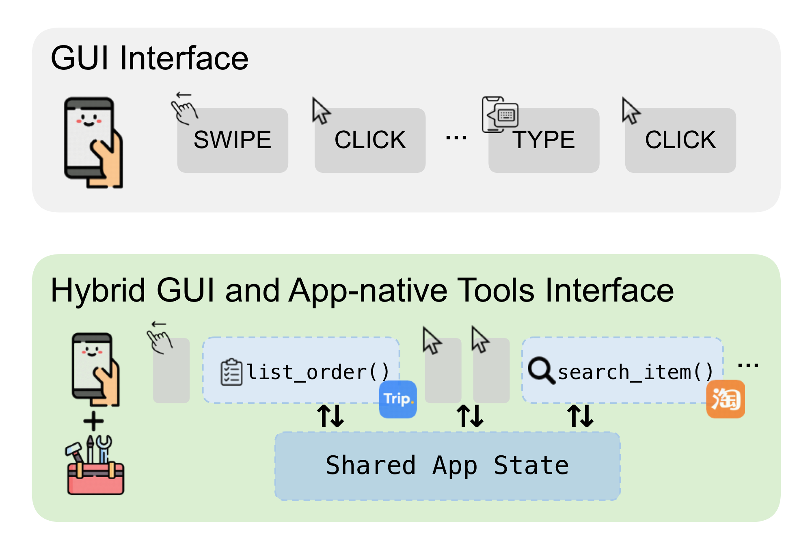
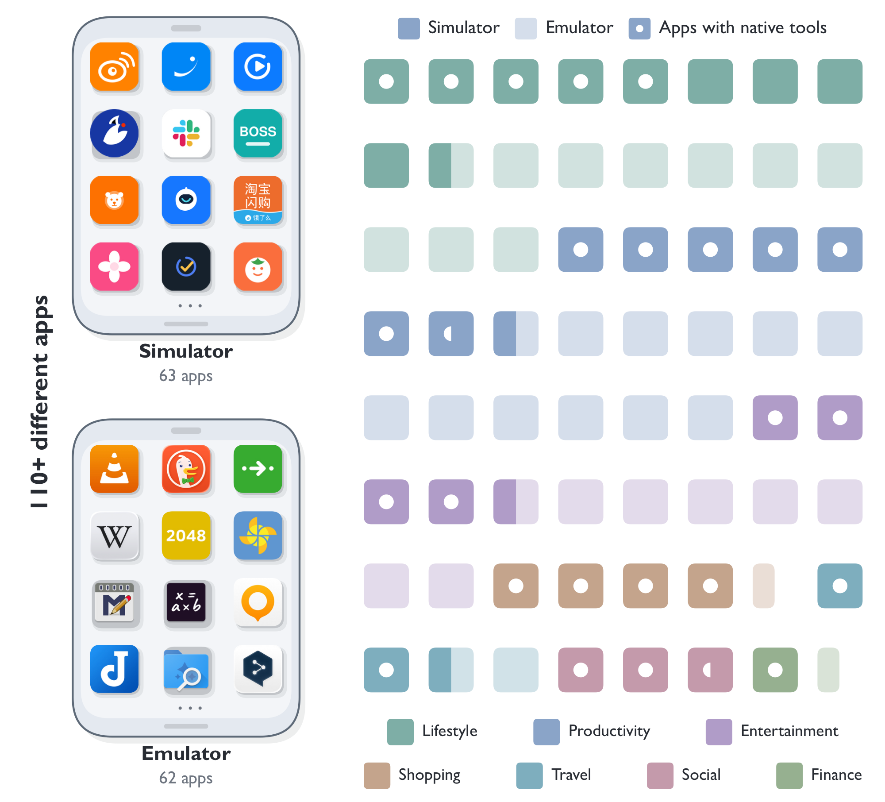
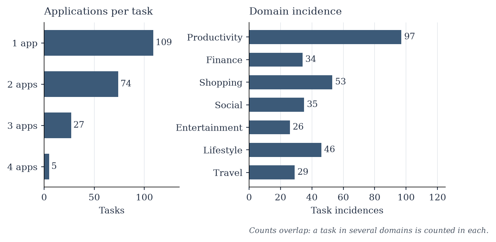

# MobileGym++

<p align="center">
  <a href="README.md"><b>English</b></a>
  &nbsp;·&nbsp;
  <a href="https://os-copilot.github.io/OpenMobile2-Home"><b>主页</b></a>
  &nbsp;·&nbsp;
  <a href="https://github.com/OpenMobile2/OpenMobile2-Code"><b>智能体代码</b></a>
  &nbsp;·&nbsp;
  <a href="https://huggingface.co/datasets/OpenMobile-2/OpenMobile-Data"><b>数据集</b></a>
  &nbsp;·&nbsp;
  <a href="https://huggingface.co/OpenMobile-2/OpenMobile-27B"><b>模型</b></a>
  &nbsp;·&nbsp;
  <a href="https://mobilegym-mock-production.up.railway.app"><b>打开手机</b></a>
</p>

<p align="center">
  <a href="LICENSE"></a>
  <a href="bench_env/benchmark/official.json"></a>
  <a href="#这部手机"></a>
</p>

<p align="center">
  
</p>

<p align="center">
  <em>同一道题，同一份应用状态，同一套检查器。</em><br>
  上面一条只点屏幕。下面一条把这些手势和应用自己的工具交替使用。
</p>

移动智能体要完成的是商业应用上的真实流程：订一段行程、付一笔订单、把一个应用里的值带到另一个应用里。这些流程很长，该被检查的是应用自己的记录变了没有。

**MobileGym++** 是一部在浏览器里运行的手机，因此这些流程可以重置、重放，也可以并行跑很多部。它在 [MobileGym](https://arxiv.org/abs/2605.26114) 上继续做了 35 个新的商业风格应用，补上了明确的跨应用机制，并试验了一种新的用法：应用在图形界面旁边，把自己的一部分功能暴露成工具。智能体看到的是屏幕像素，没有无障碍树，也不能直接读取业务状态。整机状态可以完整序列化，所以每一次训练或评测都能从同一份快照开始。

这个仓库就是这部手机，加上在它上面的 **MobileGym++ Bench**：215 道题，每题由程序检查应用状态。训练轨迹、安卓模拟器里的应用，以及发布的模型，在 [OpenMobile2](https://github.com/OpenMobile2/OpenMobile2-Code)。

## 两条路，一份状态

计算机使用正在走出「只会点界面」。MobileGym++ 把这件事做到手机上。这里的工具不是事后接上去的外部接口。每个工具都是对本应用自己对象的一次结构化查询或写入，改的是点击和输入也会改的那份持久状态。像 `search_item` 这样的调用，和点进同一页面的那些点击，写的是同一份存储。因此只点屏幕和可调工具共用题目、初始状态和检查器，变的只是路径。

这样的工具有 300 多个，分布在 50 多个应用里，包括时钟、笔记这类系统客户端。工具只在对应应用位于前台时提供。基准里的每一题仍然可以只靠图形界面做完。

| | 只点屏幕 | 可调工具 |
| --- | --- | --- |
| 参数 | `--mode gui_only` | `--mode hybrid` |
| 智能体能做的 | 在截图上点击、输入、滑动 | 同样的手势，再加上前台应用的工具 |
| 检查的是 | 做完之后的应用状态 | 同一份应用状态 |

## 这部手机

手机里装了 **63** 个客户端：这次新做的 **35** 个，加上从 MobileGym 留下来的 **28** 个。其中 **47** 个是商业风格应用，**16** 个是系统客户端。覆盖出行、购物、财务、内容、社交、办公和本地生活。

<p align="center">
  
</p>

上面那部是这个仓库。下面那部是随 OpenMobile2 发布的安卓模拟器，那些应用不在这次克隆里。每一格代表两个应用。圆点表示该应用暴露了自带工具。

每个客户端保管自己的业务对象，例如订单、账单、行程、消息，并随着操作变化。剪贴板、应用间分享、支付跳转和媒体选择把它们连起来，所以一条流程可以离开一个应用，写进另一个应用。整机可以做成快照再恢复，训练回合和评测因此从同一处出发。

新客户端里，中位水平是 37 条路由、166 个可交互动作、86 次页面跳转，从首页出发的中位深度是 3。和仍留在这部手机上的 12 个 MobileGym 业务应用比，新客户端的可交互动作是 1.48 倍，页面跳转是 1.91 倍。

<details>
<summary>客户端名单</summary>

**商业。** 支付宝、淘宝、淘宝闪购、京东、拼多多、闲鱼、唯品会、苏宁易购、eBay、卡皮记账。

**本地生活。** 美团外卖、大众点评、携程旅行、去哪儿旅行、滴滴出行、铁路 12306、地图、菜鸟、瑞幸咖啡。

**社交和内容。** 微信、小红书、微博、哔哩哔哩、豆瓣、Reddit、X、微信读书、番茄免费小说、喜马拉雅、播客、网易云音乐、Spotify、腾讯视频、优酷视频、猫眼。

**工作和日常。** Slack、腾讯会议、Google 云端硬盘、邮件、滴答清单、flomo、倒数日、番茄 ToDo、小日常、BOSS 直聘、百词斩、Keep、美柚。

**系统，在 `system/`。** 答题卡、浏览器、计算器、计算器 2、日历、时钟、指南针、电话、文件、相册、笔记、设置、短信、主题商店。

天气和网易云音乐放在 `apps/` 里，计入系统客户端。所以磁盘上 `apps/` 是 49 个目录、`system/` 是 14 个，上面的计数是 47 和 16。两种算法都是这 63 个客户端。

</details>

## MobileGym++ Bench

这套题看的是：智能体能不能在这部手机里完成一次商业写入。单应用题要在较深的页面里找到、筛选并填对字段。跨应用题还要从另一个应用的实时状态里取出一个值，带过应用边界，写进正确的位置。题面写成用户目标，不点名控件、工具或检查器要读的字段。

一共 **215** 题，用到已安装客户端中的 **48** 个。109 题用 1 个应用，74 题用 2 个，27 题用 3 个，5 题用 4 个，因此跨应用的是 **106** 题。一道题可以同时属于多个领域，右图的领域次数会重叠，加起来不是 215。

<p align="center">
  
</p>

每一题是一条用户目标、一份绑定的初始状态，以及一个读取应用状态前后差的检查器。检查器不看轨迹，不看截图，也不另请模型打分。只点屏幕和可调工具用同一批题、同一批初始状态、同一套检查。报告的指标是成功率。

题面、稳定 id 和说明在 [`bench_env/benchmark/official.json`](bench_env/benchmark/official.json)。

### 和其他环境怎么比

下表里的「商业应用」与论文用的是同一种算法：MobileGym++ 的 35 是这次新做的应用。手机里同时还留着更早的客户端，可安装的一共 63 个。

| 环境 | 平台 | 商业应用 | 题目 | 跨应用 | 图形界面 | 应用自带工具 | 可重置 |
| --- | --- | ---: | ---: | --- | --- | --- | --- |
| AppWorld | API | 9 | 750 | 有 | — | — | 有 |
| AndroidLab | 模拟器 | 5 | 138 | — | 有 | — | — |
| AndroidWorld | 模拟器 | 0 | 116 | 有 | 有 | — | — |
| SPA-Bench | 真机 | 58 | 340 | 有 | 有 | — | — |
| MobileWorld | 模拟器 | 4 | 201 | 有 | 有 | — | — |
| MobileGym | 模拟器 | 12 | 416 | 有限 | 有 | — | 有 |
| **MobileGym++** | **模拟器** | **35** | **215** | **有** | **有** | **有** | **有** |

## 目录

| 路径 | 是什么 |
| --- | --- |
| `apps/` | 商业风格客户端，以及天气和网易云音乐 |
| `system/` | 系统客户端：时钟、笔记、日历、文件、设置，以及其他 |
| `os/` | 设备外壳：桌面、状态栏、文件、剪贴板、通知 |
| `app_tools/` | 应用自带工具的 schema 和处理函数 |
| `bench_env/benchmark/` | 215 题和 `run.sh` |
| `bench_env/task/` | 题目的初始化和检查器 |
| `docs/getting-started.md` | 从刚克隆到跑完一道题 |

想用产品，就打开手机。想给模型打分，就看 `bench_env/benchmark/`。

## 打开手机

需要 Node.js 22 或更新版本。

```bash
git clone https://github.com/OpenMobile2/openmobile2.git
cd openmobile2
npm install
VITE_CDN_BASE=https://cdn.mobilegym.dev npm run dev
```

Vite 会打印地址，一般是 `http://127.0.0.1:3000`。`VITE_CDN_BASE` 让壁纸和应用里较大的内容图从公开媒体地址加载，和线上那部手机用的是同一处。每个客户端自己的界面图已经在克隆下来的仓库里。

线上已经有一部可点的手机：<https://mobilegym-mock-production.up.railway.app>。

地图、实时天气和手机里的助手可以读可选的 `VITE_*`。215 道题按自带的离线快照来写，不需要这些密钥。从克隆到判完一道题的步骤在 [`docs/getting-started.md`](docs/getting-started.md)。

## 跑 215 题

需要 Python 3.11 或更新版本。先把手机开着，再在仓库根目录执行：

```bash
python3 -m pip install -r bench_env/requirements.txt
python3 -m playwright install chromium

zsh bench_env/benchmark/run.sh \
  --mode hybrid \
  --env-url http://127.0.0.1:3000 \
  --model-base-url http://HOST:PORT/v1 \
  --model-name YourModel \
  --model-api-key "$OPENAI_API_KEY" \
  --output-dir runs/bench-hybrid
```

模型地址用任何兼容 OpenAI `/v1` 的接口。`--mode gui_only` 仍是这 215 题和同一套检查器，只是关掉应用自带工具。跑完会在输出目录写下 `results.jsonl`、`summary.json` 和每题的记录。细节在 [`bench_env/benchmark/README.md`](bench_env/benchmark/README.md)。

并行比较多的时候，先构建静态页面，再用 `scripts/server/start_nginx_gateway.sh`。做法写在入门文档里。Vite 的开发服务器是单进程。

## 许可

代码是 Apache 2.0，见 [`LICENSE`](LICENSE)。数据条款、第三方免责声明和声明分别在 [`LICENSE-DATA`](LICENSE-DATA)、[`DISCLAIMER.md`](DISCLAIMER.md)、[`NOTICE`](NOTICE)。这些模拟应用是研究用的目标，不是它们所模仿的产品，本项目也与那些公司没有隶属关系。
